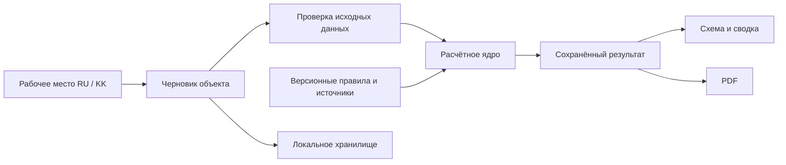

# Техническая структура

## Основные решения

React + TypeScript + Vite для интерфейса. Расчёт — отдельный детерминированный модуль. SVG для схемы и меток, Lucide для иконок. Минимальное количество зависимостей; они выбираются под конкретную функцию, а не ради количества инструментов.

Первый прототип работает на устройстве. Черновик хранится локально с версией схемы; пользователь может выгрузить резервную копию. Сохранение на одном устройстве не означает синхронизацию между телефоном и компьютером. Облачное хранение и роли — самостоятельный этап пилота.

Симуляции реализованы в `domain/scenarios.mjs`: построение гипотетического изменения и сравнение через существующее ядро. UI — `components/ScenarioExplorer.tsx`. `components/Scenes.tsx` содержит оригинальные предметные SVG. `Zone.notes` — необязательное совместимое поле. `npm test` запускает `scripts/test.mjs`, объединяющий существенные проверки ядра и сценариев.

## Границы модулей



Рендеринг не содержит нормативных коэффициентов. PDF не рассчитывает потребность повторно и не читает изменённый черновик вместо своего снимка.

## Предлагаемая организация файлов

```text
src/
  App.tsx                 # рабочее место и навигация
  domain/                 # схема данных, валидация, расчёт
  data/                   # демо и реестр источников
  components/             # схема, параметры, результаты, отчёт
  locales/                # ru / kk
  lib/                    # сохранение, экспорт, общие помощники
  styles/                 # дизайн-токены и адаптивные стили
public/fonts/             # локальные шрифты и лицензия
docs/                     # продуктовый и технический контекст
```

Дерево — целевая организация. Реальное состояние и расхождения фиксировать в HANDOFF.

## Данные

`Building`: id, название/адрес, назначение, демонстрационный статус, инспектор, дата, этажи.

`Floor`: id, название, зоны, изображение плана и метки. `Zone`: id, название, площадь, класс(ы), категория при необходимости, условия с явным значением «неизвестно», сведения об оборудовании.

`CalculationSnapshot`: id, время, версия входных данных/их хеш, версия правил, копия исходных данных, строки результата, требуемые уточнения и ограничения. Отдельно хранится состояние проверки размещения.

Для ключей использовать стабильные id, а не переведённые названия. Количества — целые неотрицательные числа, площади — конечные положительные значения. Пользовательский ввод проверяется при редактировании и импорте.

## Схема и план

Геометрия схемы — представление зон, не вход в расчёт площади. Изменение размера блока мышью не изменяет фактическую площадь. План хранит нормализованные координаты меток от 0 до 1; масштабирование интерфейса не сдвигает метки.

Изображение ограничивается по размеру и типу. Сохраняемые данные не должны незаметно потеряться из-за квоты браузера. При ошибке сохранения показывать явное сообщение и предлагать резервный экспорт.

## PDF и локализация

Предпочтение — `@react-pdf/renderer`: текст, переносы, встраивание статических TTF, страницы. Нужен реальный PDF-файл с казахскими буквами. Не использовать стандартный Helvetica без кириллического шрифта.

Документация [react-pdf о шрифтах](https://react-pdf.org/docs/v4/fonts) предупреждает об ограничениях variable fonts: для PDF используются отдельные статические начертания. Один набор данных и переводов обслуживает экран и отчёт.

## Официальная документация инструментов

Проверена 23.10.2026: [React](https://react.dev/), [Vite](https://vite.dev/guide/), [Lucide](https://lucide.dev/guide/react), [Radix](https://www.radix-ui.com/primitives/docs/overview/introduction), [React Hook Form](https://react-hook-form.com/), [Zod](https://zod.dev/), [react-i18next](https://react.i18next.com/), [Dexie](https://dexie.org/docs), [react-pdf](https://react-pdf.org/docs/v4/fonts).

Это рассмотренные средства, не список обязательных зависимостей. Небольшой прототип может обойтись обычными React-формами и локальным словарём; усложнение хранения или формы должно иметь конкретную причину. Версии фиксируются lock-файлом при реализации.

## Проверки

Существенные сценарии ядра: граница площади, пустое/некорректное значение, независимость этажей, неподдержанные опасности, чувствительная электроника, неизвестные условия, неизменность снимка, устаревание результата. Затем сборка, мобильная компоновка, языки и читаемый PDF.

Результаты проверок и ограничения среды записывать в HANDOFF. Успешная сборка не заменяет нормативную проверку и пользовательский просмотр.

## Расширение 24.10.2026

`data/templates.ts` задаёт шесть структур без вымышленных характеристик. `Building.kind` управляет типологией, `Building.usage` ограничивает область расчёта. Валидация сохраняет совместимость со старыми JSON.

`domain/inspection.mjs` — статусы записей, календарные сроки, сводка, валидация и CSV. `InspectionWorkspace.tsx` — обход и редактор оборудования, `ObjectLibrary.tsx` — независимые объекты, `ObjectIllustration.tsx` — оригинальные типологические SVG. Стили расширения в `styles/fieldwork.css`.

Сохранение localStorage теперь использует обёртку v2 для всей библиотеки и activeId в прежнем ключе. Запись атомарная для одного значения; изображение активного плана не дублируется в отдельном ключе. Внешний резервный JSON остаётся копией одного объекта v1. Поля `Zone.inspection` и `Zone.assets` необязательные, входят в снимок и PDF. Реестр не влияет на ручное поле existing.

23 существенные проверки охватывают также календарные границы, устаревание осмотра, импорт реестра, ограничения назначения и защиту CSV. Браузерный сценарий дополнен переключением/восстановлением нескольких объектов, оборудованием, обходом и несохранённой формой.

## Конструктор блоков и реальная геометрия

`Floor.layout` — необязательная совместимая геометрия в метрах. `domain/layout.mjs` валидирует ортогональные контуры и проёмы, проверяет внутренние пересечения, применяет черновик к этажу и экспортирует SVG. Пожарное ядро продолжает читать `Zone.area`, пока пользователь отдельно не перенесёт площади.

`room-presets.mjs` задаёт темы и начальные размеры; `block-layout.mjs` размещает автоматические проёмы при примыкании к коридору; `furniture.mjs` генерирует ограниченный набор условных примитивов для DOM/SVG/PDF. Тип обозначения не определяет пожарный класс.

`PlanEditor.tsx` держит временный черновик и undo/redo; `PlanDrawing.tsx` показывает сохранённую геометрию; `PlanPDF.tsx` выводит векторный лист отчёта. Старый `Diagram.tsx` не используется. Новый экран оформлен в `studio.css`; старые общие стили форм/диалогов пока остаются для совместимости других экранов.

При правке числовых размеров нельзя переносить значение из панели ранее выбранной комнаты в новую: поля обновляются по id комнаты и применяются только после реального изменения пользователем. Координата окончания pointer-жеста считается непосредственно на pointerup.
